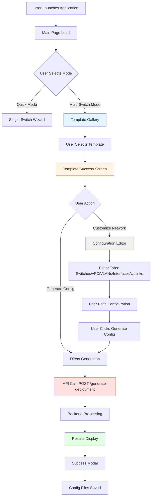
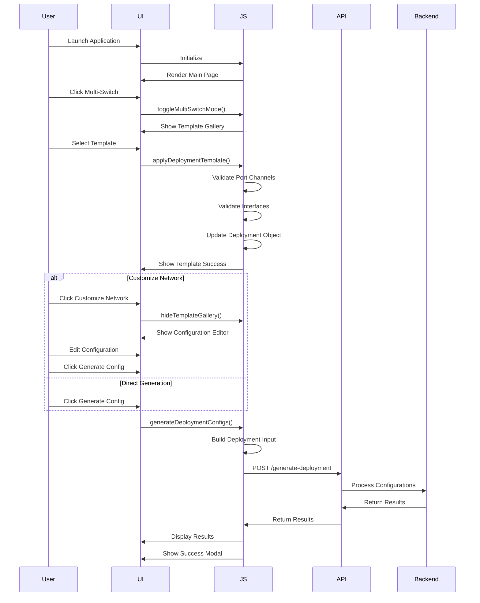

# Multi-Switch User Flow Documentation

**Version:** 6.38.1  
**Date:** 2026-07-29  
**Purpose:** Complete step-by-step documentation of multi-switch configuration flow for QA testing

---

## Overview

This document provides a detailed walkthrough of the multi-switch configuration flow in the NX-OS Configuration Authority. Each step includes the HTML page structure, expected results, user actions, and next steps to establish a common language for QA testing.

---

## System Architecture Diagram



---

## Step-by-Step Multi-Switch Flow

### Step 1: Application Launch

**User Action:** User launches `NXOS_Configurator_Web_v6.38.1.exe`

**Expected HTML Page Structure:**
```html
<body>
    <div class="container">
        <header class="app-header">
            <h1>NX-OS Configuration Authority</h1>
            <div class="subtitle">
                <span id="buildVersion">6.38.1</span>
                <span class="dot">·</span>
                <span id="offlineBadge" class="badge ok">Offline Ready</span>
            </div>
            <div class="header-actions">
                <div class="header-dropdown">
                    <button id="modeDropdownBtn">Mode: Quick <span class="dropdown-arrow">▾</span></button>
                    <div class="dropdown-menu" id="modeDropdown">
                        <button data-action="set-wizard-mode" data-mode="quick">Quick</button>
                        <button data-action="set-wizard-mode" data-mode="architect">Architect</button>
                        <button data-action="toggle-multi-switch">Multi-Switch</button>
                        <button data-action="toggle-training" id="trainingModeToggle">Training</button>
                    </div>
                </div>
                <!-- Other dropdowns... -->
            </div>
        </header>
        
        <div class="wizard-panel">
            <nav class="wizard-nav">
                <button class="step-btn active" data-step="1">1 Mode</button>
                <button class="step-btn" data-step="2">2 vPC</button>
                <!-- More steps... -->
            </nav>
            
            <div class="wizard-step active" id="step-1">
                <h2 class="step-title">What is this switch's role?</h2>
                <div id="modeGrid" class="choice-grid"></div>
            </div>
        </div>
    </div>
</body>
```

**Expected Result:**
- Application loads in browser at `http://127.0.0.1:9000`
- Header shows version "6.38.1" and "Offline Ready" badge
- Mode dropdown shows "Mode: Quick"
- Wizard panel shows Step 1 with mode selection grid
- Template gallery is hidden

**Next Step:** User clicks "Multi-Switch" in mode dropdown

---

### Step 2: Enable Multi-Switch Mode

**User Action:** User clicks "Multi-Switch" button in mode dropdown

**JavaScript Function:** `toggleMultiSwitchMode()` (app.js:4500-4551)

**Expected HTML Page Structure:**
```html
<div class="template-gallery" id="templateGallery" role="region">
    <h3 class="gallery-title">Multi-Switch Deployment Templates</h3>
    <p class="gallery-desc">Choose a starting point for your network — one click to full configuration</p>
    
    <!-- Filter Buttons -->
    <div class="template-filters">
        <button class="filter-btn active" data-filter="all">All</button>
        <button class="filter-btn" data-filter="production_dc">Production DC</button>
        <button class="filter-btn" data-filter="cloud_vm">Cloud/VM</button>
        <button class="filter-btn" data-filter="enterprise_campus">Enterprise Campus</button>
    </div>
    
    <!-- Template Grid -->
    <div id="templateGrid" class="template-grid" role="list">
        <!-- Template cards rendered here -->
    </div>
    
    <button class="btn-outline btn-sm" data-action="hide-template-gallery">Use Manual Configuration</button>
</div>

<div class="configuration-editor hidden" id="configurationEditor">
    <!-- Editor content (hidden initially) -->
</div>
```

**Expected Result:**
- Mode dropdown button text changes to "Mode: Multi-Switch"
- Template gallery becomes visible (hidden class removed)
- Template grid shows available deployment templates:
  - vPC Core + Leaf Pairs
  - Spine-Leaf Fabric
  - 6-Switch Fabric
  - Dual Core + Access
  - Core + Leaf (2 switches)
  - Spine + Leaf (2 switches)
- Configuration editor remains hidden
- Single-switch wizard steps remain visible but inactive

**Next Step:** User selects a template from the gallery

---

### Step 3: Template Selection

**User Action:** User clicks on a template card (e.g., "vPC Core + Leaf Pairs")

**JavaScript Function:** `applyDeploymentTemplate(templateKey)` (app.js:620-709)

**Template Card HTML Structure:**
```html
<div class="template-card" data-template-id="vpc_core_leaf" role="listitem">
    <div class="template-header">
        <h4>vPC Core + Leaf Pairs</h4>
        <span class="complexity-badge medium">Medium</span>
        <span class="best-practice-badge">✓ Best Practice</span>
    </div>
    <p class="template-desc">Best for data centers needing high availability. Two core switches with redundant connections to leaf switches.</p>
    
    <div class="template-meta">
        <span class="meta-item"><strong>4</strong> switches</span>
        <span class="meta-item"><strong>2</strong> vPC domains</span>
        <span class="meta-item">VLAN: 10-50</span>
    </div>
    
    <div class="template-compatibility">
        <span class="compatibility-label">Compatible:</span>
        <span class="compatibility-models">Nexus 9336C-FX2, 93180YC-EX, 9348GC-FXP</span>
    </div>
    
    <button class="template-action btn-primary" data-action="apply-template" data-template-id="vpc_core_leaf">
        Apply Template
    </button>
</div>
```

**Expected Result:**
- Loading spinner appears in template gallery
- JavaScript calls `applyDeploymentTemplate('vpc_core_leaf')`
- Template data is loaded into `deployment` object:
  ```javascript
  deployment = {
      switches: [
          { hostname: "CORE1", role: "core", model: "Nexus 9336C-FX2", ... },
          { hostname: "CORE2", role: "core", model: "Nexus 9336C-FX2", ... },
          { hostname: "LEAF10G-1", role: "leaf", model: "Nexus 93180YC-EX", ... },
          { hostname: "LEAF10G-2", role: "leaf", model: "Nexus 93180YC-EX", ... }
      ],
      vpc_pairs: [
          { domain: "10", primary: "CORE1", secondary: "CORE2", ... },
          { domain: "100", primary: "LEAF10G-1", secondary: "LEAF10G-2", ... }
      ],
      uplinks: [
          { from: "LEAF10G-1", to: "CORE1", ports: "E1/53", po_id: "10" },
          // ... more uplinks
      ],
      global_vlans: [
          { id: 10, name: "Data-VLAN-10" },
          { id: 20, name: "Data-VLAN-20" },
          // ... more VLANs
      ]
  }
  ```
- Port channel validation runs
- Interface format validation runs
- Template success screen appears after 500ms

**Next Step:** Template success screen appears

---

### Step 4: Template Success Screen

**User Action:** None (automatic after template application)

**JavaScript Function:** `showTemplateSuccess(template)` (app.js:724-768)

**Expected HTML Page Structure:**
```html
<div class="template-gallery" id="templateGallery">
    <div class="template-success">
        <div class="success-icon">✓</div>
        <h3>Template Applied: vPC Core + Leaf Pairs</h3>
        <p>Your network is ready to customize</p>
        
        <div class="topology-preview">
            <svg width="400" height="300" viewBox="0 0 400 300">
                <!-- SVG topology visualization -->
                <line x1="50" y1="75" x2="150" y2="75" stroke="#9CA3AF" stroke-width="2" stroke-dasharray="5,5"/>
                <!-- More lines for connections -->
                <rect x="50" y="50" width="80" height="50" fill="#3B82F6" rx="4"/>
                <text x="90" y="70" fill="white">CORE1</text>
                <!-- More switches -->
            </svg>
        </div>
        
        <div class="configuration-summary">
            <h4>Configuration Summary</h4>
            <ul>
                <li><strong>4</strong> switches (core, core, leaf, leaf)</li>
                <li><strong>2</strong> vPC domains (10, 100)</li>
                <li><strong>4</strong> uplinks configured</li>
                <li><strong>VLAN range:</strong> 10-50</li>
                <li><strong>All interfaces</strong> pre-configured</li>
            </ul>
        </div>
        
        <div class="template-actions">
            <button class="btn-primary" data-action="hide-template-gallery">Customize Network</button>
            <button class="btn-outline" data-action="generate-config">Generate Config</button>
            <button class="btn-ghost" data-action="render-template-gallery">Change Template</button>
            <button class="btn-ghost" data-action="save-as-custom-template">Save as Template</button>
        </div>
    </div>
</div>
```

**Expected Result:**
- Success icon (✓) displayed
- Template name shown: "Template Applied: vPC Core + Leaf Pairs"
- Topology preview SVG shows network layout with switches and connections
- Configuration summary shows:
  - 4 switches with roles
  - 2 vPC domains
  - 4 uplinks
  - VLAN range
- Action buttons available:
  - **Customize Network** (primary) - enters configuration editor
  - **Generate Config** (outline) - generates configs directly
  - **Change Template** (ghost) - returns to template gallery
  - **Save as Template** (ghost) - saves as custom template

**Next Step:** User chooses between "Customize Network" or "Generate Config"

---

### Step 5A: Configuration Editor (Customize Network)

**User Action:** User clicks "Customize Network"

**JavaScript Function:** `hideTemplateGallery()` (app.js:1740-1779)

**Expected HTML Page Structure:**
```html
<div class="template-gallery hidden" id="templateGallery">
    <!-- Hidden -->
</div>

<div class="configuration-editor" id="configurationEditor" role="region">
    <div class="editor-header">
        <h3>Network Configuration Editor</h3>
        <div class="editor-actions">
            <button class="btn-ghost btn-sm" data-action="validate-topology">Validate</button>
            <button class="btn-ghost btn-sm" data-action="reset-to-template">Reset</button>
            <button class="btn-ghost btn-sm" data-action="save-custom-template">Save as Template</button>
            <button class="btn-primary btn-sm" data-action="generate-config">Generate Config</button>
        </div>
    </div>
    
    <div class="editor-layout">
        <!-- Topology Canvas -->
        <div class="topology-canvas" role="img">
            <div id="editorTopologyContainer">
                <svg width="100%" height="400" viewBox="0 0 600 400">
                    <!-- Live topology SVG -->
                </svg>
            </div>
            <div class="canvas-actions">
                <button class="btn-sm" data-action="add-switch">+ Add Switch</button>
                <button class="btn-sm" data-action="add-vpc-domain">+ Add vPC Domain</button>
            </div>
        </div>
        
        <!-- Configuration Panels -->
        <div class="config-panels" role="tablist">
            <div class="panel-tabs" role="tablist">
                <button class="tab-btn active" data-tab="switches" role="tab">Switches</button>
                <button class="tab-btn" data-tab="vpc" role="tab">vPC Domains</button>
                <button class="tab-btn" data-tab="vlans" role="tab">VLANs</button>
                <button class="tab-btn" data-tab="interfaces" role="tab">Interfaces</button>
                <button class="tab-btn" data-tab="uplinks" role="tab">Uplinks</button>
            </div>
            
            <div class="panel-content">
                <!-- Switches Panel (active by default) -->
                <div id="panel-switches" class="tab-panel active" role="tabpanel">
                    <div class="panel-header">
                        <h4>Switches</h4>
                        <button class="btn-sm" data-action="add-switch">+ Add Switch</button>
                    </div>
                    <div id="switchesList" role="list">
                        <div class="switch-item">
                            <div class="switch-item-header">
                                <strong>CORE1</strong>
                                <div class="switch-item-actions">
                                    <button class="btn-sm" data-action="edit-switch" data-index="0">Edit</button>
                                    <button class="btn-sm" data-action="clone-switch" data-index="0">Clone</button>
                                    <button class="btn-sm btn-danger" data-action="remove-switch" data-index="0">Remove</button>
                                </div>
                            </div>
                            <div class="switch-item-details">
                                <span>Role: core</span>
                                <span>Model: Nexus 9336C-FX2</span>
                                <span>IP: 10.0.0.1/24</span>
                                <span>vPC Domain: 10</span>
                            </div>
                        </div>
                        <!-- More switch items -->
                    </div>
                </div>
                
                <!-- Other panels (hidden by default) -->
                <div id="panel-vpc" class="tab-panel hidden" role="tabpanel">...</div>
                <div id="panel-vlans" class="tab-panel hidden" role="tabpanel">...</div>
                <div id="panel-interfaces" class="tab-panel hidden" role="tabpanel">...</div>
                <div id="panel-uplinks" class="tab-panel hidden" role="tabpanel">...</div>
            </div>
        </div>
    </div>
</div>
```

**Expected Result:**
- Template gallery becomes hidden
- Configuration editor becomes visible
- Topology canvas shows live SVG visualization of network
- Switches panel is active by default
- All 4 switches from template are listed:
  - CORE1 (core, Nexus 9336C-FX2, 10.0.0.1/24, vPC Domain 10)
  - CORE2 (core, Nexus 9336C-FX2, 10.0.0.2/24, vPC Domain 10)
  - LEAF10G-1 (leaf, Nexus 93180YC-EX, 10.0.0.11/24, vPC Domain 100)
  - LEAF10G-2 (leaf, Nexus 93180YC-EX, 10.0.0.12/24, vPC Domain 100)
- Each switch has Edit, Clone, Remove buttons
- Editor header has Validate, Reset, Save as Template, Generate Config buttons

**Next Step:** User can edit switches, switch tabs, or click Generate Config

---

### Step 5B: Direct Generation (Skip Editor)

**User Action:** User clicks "Generate Config" from template success screen

**JavaScript Function:** `generateDeploymentConfigs()` (app.js:6420-6567)

**Expected Result:**
- Loading overlay appears with spinner
- JavaScript constructs deployment input payload:
  ```javascript
  deploymentInput = {
      switches: [
          { hostname: "CORE1", mgmt_ip: "10.0.0.1/24", model: "Nexus 9336C-FX2", role: "core", ... },
          // ... all switches
      ],
      vpc_pairs: [...],
      uplinks: [...],
      global_vlans: [...],
      output_dir: null,
      site_name: "HQ"
  }
  ```
- API call made: `POST /generate-deployment` with JSON payload
- Backend processes each switch configuration
- Loading overlay removed after response

**Next Step:** Backend processes and returns results

---

### Step 6: Configuration Editor Tab Navigation

**User Action:** User clicks different tabs (vPC Domains, VLANs, Interfaces, Uplinks)

**JavaScript Function:** Tab switching via event delegation in `ui-handlers.js`

**Expected HTML Structure for Each Tab:**

**vPC Domains Tab:**
```html
<div id="panel-vpc" class="tab-panel active" role="tabpanel">
    <div class="panel-header">
        <h4>vPC Domains</h4>
        <button class="btn-sm" data-action="add-vpc-domain">+ Add vPC Domain</button>
    </div>
    <div id="vpcList" role="list">
        <div class="vpc-item">
            <div class="vpc-item-header">
                <strong>Domain 10</strong>
                <div class="vpc-item-actions">
                    <button class="btn-sm" data-action="edit-vpc" data-index="0">Edit</button>
                    <button class="btn-sm btn-danger" data-action="remove-vpc" data-index="0">Remove</button>
                </div>
            </div>
            <div class="vpc-item-details">
                <span>Primary: CORE1</span>
                <span>Secondary: CORE2</span>
                <span>Peer Link: E1/35-36</span>
            </div>
        </div>
        <!-- More vPC domains -->
    </div>
</div>
```

**VLANs Tab:**
```html
<div id="panel-vlans" class="tab-panel active" role="tabpanel">
    <div class="panel-header">
        <h4>VLAN Configuration</h4>
        <button class="btn-sm" data-action="bulk-add-vlans">Bulk Add</button>
    </div>
    <div id="vlanList" role="list">
        <div class="vlan-item">
            <span class="vlan-id">10</span>
            <span class="vlan-name">Data-VLAN-10</span>
            <button class="btn-sm btn-danger" data-action="remove-vlan" data-id="10">Remove</button>
        </div>
        <!-- More VLANs -->
    </div>
</div>
```

**Interfaces Tab:**
```html
<div id="panel-interfaces" class="tab-panel active" role="tabpanel">
    <div class="panel-header">
        <h4>Interface Templates</h4>
    </div>
    <div class="interface-templates" role="group">
        <button class="template-btn" data-action="apply-interface-template" data-template="server">Server Port</button>
        <button class="template-btn" data-action="apply-interface-template" data-template="phone">IP Phone</button>
        <button class="template-btn" data-action="apply-interface-template" data-template="ap">AP Port</button>
        <button class="template-btn" data-action="apply-interface-template" data-template="iscsi">iSCSI Storage</button>
        <button class="template-btn" data-action="apply-interface-template" data-template="mgmt">Management</button>
        <button class="template-btn" data-action="apply-interface-template" data-template="lacp">LACP</button>
    </div>
</div>
```

**Uplinks Tab:**
```html
<div id="panel-uplinks" class="tab-panel active" role="tabpanel">
    <div class="panel-header">
        <h4>Uplinks</h4>
        <button class="btn-sm" data-action="add-uplink">+ Add Uplink</button>
    </div>
    <div id="uplinkList" role="list">
        <div class="uplink-item">
            <span class="uplink-from">LEAF10G-1</span>
            <span class="uplink-arrow">→</span>
            <span class="uplink-to">CORE1</span>
            <span class="uplink-ports">E1/53</span>
            <span class="uplink-po">PO10</span>
            <button class="btn-sm btn-danger" data-action="remove-uplink" data-index="0">Remove</button>
        </div>
        <!-- More uplinks -->
    </div>
</div>
```

**Expected Result:**
- Clicked tab becomes active (active class)
- Previous tab becomes hidden
- Panel content updates to show relevant data
- Tab buttons update aria-selected attributes

**Next Step:** User can edit items in active tab or click Generate Config

---

### Step 7: Switch Editing

**User Action:** User clicks "Edit" button on a switch (e.g., CORE1)

**JavaScript Function:** Opens edit modal via event delegation

**Expected HTML Modal Structure:**
```html
<div id="editSwitchModal" class="modal-backdrop" role="dialog" aria-modal="true">
    <div class="modal-content">
        <div class="modal-header">
            <h3>Edit Switch: CORE1</h3>
            <button class="modal-close" data-action="close-modal" aria-label="Close modal">×</button>
        </div>
        
        <div class="modal-body">
            <form id="editSwitchForm">
                <div class="form-group">
                    <label for="editHostname">Hostname</label>
                    <input type="text" id="editHostname" name="hostname" value="CORE1" required>
                </div>
                
                <div class="form-group">
                    <label for="editRole">Role</label>
                    <select id="editRole" name="role">
                        <option value="core" selected>Core</option>
                        <option value="spine">Spine</option>
                        <option value="leaf">Leaf</option>
                        <option value="access">Access</option>
                    </select>
                </div>
                
                <div class="form-group">
                    <label for="editModel">Model</label>
                    <select id="editModel" name="model">
                        <option value="Nexus 9336C-FX2" selected>Nexus 9336C-FX2</option>
                        <option value="Nexus 93180YC-EX">Nexus 93180YC-EX</option>
                        <option value="Nexus 9348GC-FXP">Nexus 9348GC-FXP</option>
                    </select>
                </div>
                
                <div class="form-group">
                    <label for="editMgmtIp">Management IP</label>
                    <input type="text" id="editMgmtIp" name="mgmt_ip" value="10.0.0.1/24" required>
                </div>
                
                <div class="form-group">
                    <label for="editMgmtGw">Management Gateway</label>
                    <input type="text" id="editMgmtGw" name="mgmt_gw" value="10.0.0.254">
                </div>
                
                <div class="form-group">
                    <label for="editVpcDomain">vPC Domain</label>
                    <input type="number" id="editVpcDomain" name="vpc_domain" value="10">
                </div>
                
                <div class="form-group">
                    <label for="editBaseVlan">Base Access VLAN</label>
                    <input type="number" id="editBaseVlan" name="base_access_vlan" value="10">
                </div>
                
                <div class="form-group">
                    <label for="editVlanCount">Access VLAN Count</label>
                    <input type="number" id="editVlanCount" name="access_vlan_count" value="4">
                </div>
            </form>
        </div>
        
        <div class="modal-footer">
            <button class="btn-outline" data-action="close-modal">Cancel</button>
            <button class="btn-primary" data-action="save-switch">Save Changes</button>
        </div>
    </div>
</div>
```

**Expected Result:**
- Modal overlay appears with backdrop
- Modal shows current switch values in form fields
- User can edit any field
- Cancel button closes modal without saving
- Save Changes button updates deployment object and re-renders switch list

**Next Step:** User saves changes or cancels

---

### Step 8: Generate Configuration

**User Action:** User clicks "Generate Config" button (from editor header or template success screen)

**JavaScript Function:** `generateDeploymentConfigs()` (app.js:6420-6567)

**Expected API Request:**
```http
POST /generate-deployment HTTP/1.1
Host: 127.0.0.1:9000
Content-Type: application/json
X-Request-ID: <uuid>

{
    "switches": [
        {
            "hostname": "CORE1",
            "mgmt_ip": "10.0.0.1/24",
            "mgmt_gw": "10.0.0.254",
            "site_name": "HQ",
            "model": "Nexus 9336C-FX2",
            "nxos_version": "9.3",
            "vpc_domain": "10",
            "vpc_peer_link_id": 1,
            "keepalive_po_id": 2,
            "vpc_system_priority": 32667,
            "local_ka": "10.0.0.1",
            "remote_ka": "10.0.0.2",
            "vpc_pl_ints": "",
            "base_access_vlan": 10,
            "access_vlan_count": 4,
            "interface_count": 0,
            "bring_up_spare_ports": false,
            "security_tier": "standard",
            "role": "core",
            "baseline_options": [],
            "vlans": []
        }
        // ... more switches
    ],
    "vpc_pairs": [
        {
            "domain": "10",
            "primary": "CORE1",
            "secondary": "CORE2",
            "peer_link_ports": "E1/35-36"
        }
        // ... more vPC pairs
    ],
    "uplinks": [
        {
            "from": "LEAF10G-1",
            "to": "CORE1",
            "ports": "E1/53",
            "po_id": 10
        }
        // ... more uplinks
    ],
    "global_vlans": [
        {"id": 10, "name": "Data-VLAN-10"},
        {"id": 20, "name": "Data-VLAN-20"}
        // ... more VLANs
    ],
    "output_dir": null,
    "site_name": "HQ"
}
```

**Expected API Response:**
```json
{
    "total_switches": 4,
    "successful": 4,
    "failed": 0,
    "results": [
        {
            "hostname": "CORE1",
            "config": "! NX-OS Configuration...\nhostname CORE1\n...",
            "port_map": {...},
            "config_map": {...}
        }
        // ... more results
    ],
    "errors": [],
    "export_dir": "C:\\...\\configs\\history\\20260729_103653"
}
```

**Expected Result:**
- Loading overlay appears during API call
- Toast message shows success: "Successfully generated configurations for all 4 switches"
- Configuration results display appears
- Success modal shows completion summary
- Config files saved to `configs/history/YYYYMMDD_HHMMSS/`

**Next Step:** Results display and success modal appear

---

### Step 9: Results Display

**JavaScript Function:** `displayDeploymentResults(result)` (app.js:5000-5050)

**Expected HTML Structure:**
```html
<div id="deploymentResults" class="deployment-results">
    <h3>Configuration Results</h3>
    
    <div class="results-summary">
        <span class="success-count">4 successful</span>
        <span class="error-count">0 failed</span>
    </div>
    
    <div class="results-list">
        <div class="result-item" data-hostname="CORE1">
            <div class="result-header">
                <strong>CORE1</strong>
                <span class="status-badge success">✓ Success</span>
            </div>
            <div class="result-actions">
                <button class="btn-sm" data-action="view-config" data-hostname="CORE1">View Config</button>
                <button class="btn-sm" data-action="view-port-map" data-hostname="CORE1">Port Map</button>
                <button class="btn-sm" data-action="download-config" data-hostname="CORE1">Download</button>
            </div>
        </div>
        <!-- More result items -->
    </div>
    
    <div class="deployment-actions">
        <button class="btn-outline" data-action="show-deployment-preview">Preview Configuration</button>
        <button class="btn-primary" data-action="open-output-folder">Open Output Folder</button>
    </div>
</div>
```

**Expected Result:**
- Results panel shows all switches with status
- Each switch has View Config, Port Map, Download buttons
- Summary shows successful/failed counts
- Open Output Folder button opens file explorer

**Next Step:** Success modal appears

---

### Step 10: Success Modal

**JavaScript Function:** `showMultiSwitchSuccessModal(result)` (app.js:6569-6620)

**Expected HTML Modal Structure:**
```html
<div id="multiSwitchSuccessModal" class="modal-backdrop" role="dialog">
    <div class="modal-content">
        <div class="modal-header">
            <h3>✓ Configuration Generation Complete</h3>
            <button class="modal-close" data-action="close-modal">×</button>
        </div>
        
        <div class="modal-body">
            <div class="success-summary">
                <p>Successfully generated <strong>4</strong> configurations</p>
                <p>Output directory: <code>configs\history\20260729_103653</code></p>
            </div>
            
            <div class="created-files">
                <h4>Created Files:</h4>
                <ul>
                    <li>CORE1.cfg</li>
                    <li>CORE2.cfg</li>
                    <li>LEAF10G-1.cfg</li>
                    <li>LEAF10G-2.cfg</li>
                </ul>
            </div>
        </div>
        
        <div class="modal-footer">
            <button class="btn-outline" data-action="close-modal">Close</button>
            <button class="btn-primary" data-action="open-output-folder">Open Folder</button>
            <button class="btn-ghost" data-action="restart-config">Start New Configuration</button>
        </div>
    </div>
</div>
```

**Expected Result:**
- Success modal appears with completion summary
- Shows number of configurations generated
- Shows output directory path
- Lists all created config files
- Buttons: Close, Open Folder, Start New Configuration

**Next Step:** User closes modal or takes action

---

## Alternative Paths

### Path A: Manual Configuration (Skip Templates)

**User Action:** User clicks "Use Manual Configuration" from template gallery

**Expected Result:**
- Template gallery becomes hidden
- Configuration editor appears with empty deployment
- User must manually add switches, vPC domains, VLANs, uplinks
- Topology canvas shows empty state

**Flow:**
1. Click "Use Manual Configuration"
2. Configuration editor appears (empty)
3. Click "+ Add Switch" to add switches manually
4. Click "+ Add vPC Domain" to add vPC domains
5. Configure VLANs, interfaces, uplinks manually
6. Click "Generate Config"

---

### Path B: Change Template

**User Action:** User clicks "Change Template" from template success screen

**Expected Result:**
- Current deployment is cleared
- Template gallery re-appears
- User can select different template

**Flow:**
1. Click "Change Template"
2. Template gallery re-appears
3. Select different template
4. Template success screen appears
5. Continue with Customize Network or Generate Config

---

### Path C: Save as Custom Template

**User Action:** User clicks "Save as Template" from template success screen or editor

**Expected Result:**
- Prompt for template name
- Current deployment saved to localStorage as custom template
- Custom template appears in template gallery

**Flow:**
1. Click "Save as Template"
2. Enter template name in prompt
3. Template saved to localStorage
4. Template re-rendered with custom template included

---

## Error Handling Paths

### Error 1: Template Application Failure

**Scenario:** Template application fails (API error, validation error)

**Expected Result:**
- Error toast appears: "Template application failed: [error message]"
- Template gallery re-appears
- Deployment object remains unchanged

**Recovery:** User can select different template or use manual configuration

---

### Error 2: Configuration Generation Failure

**Scenario:** Backend fails to generate one or more configurations

**Expected Result:**
- Warning toast appears: "Generated 3/4 configurations with 1 error"
- Results show failed switches with error messages
- Successful configs still saved

**Recovery:** User can fix issues and retry generation

---

## Summary Flow Diagram



---

## QA Testing Checklist

For each step, verify:

- [ ] HTML structure matches expected
- [ ] All buttons have correct data-action attributes
- [ ] All ARIA attributes are present
- [ ] JavaScript functions execute without errors
- [ ] Expected UI state changes occur
- [ ] Data objects update correctly
- [ ] API calls use correct endpoints and payloads
- [ ] Error handling works as expected
- [ ] Toast messages appear correctly
- [ ] Modals open/close properly

---

## Next Steps

After reviewing this documentation:

1. **Validate Flow:** Walk through each step in the application to verify accuracy
2. **Update Documentation:** Correct any discrepancies found
3. **Create Test Cases:** Develop E2E tests for each path
4. **Execute QA:** Systematically test each path with different scenarios
5. **Document Bugs:** Record any issues found with step-by-step reproduction

---

**Document Version:** 1.0  
**Last Updated:** 2026-07-29  
**Author:** System Analysis  
**Status:** Ready for QA Review
