# NX-OS Configurator Program Decision Flow

## Overview

This document maps the complete decision flow, progress paths, and possibilities of the NX-OS Configuration Authority software. It visualizes how users navigate through the system, what decisions they make, and what outcomes are possible.

## System Architecture Flow

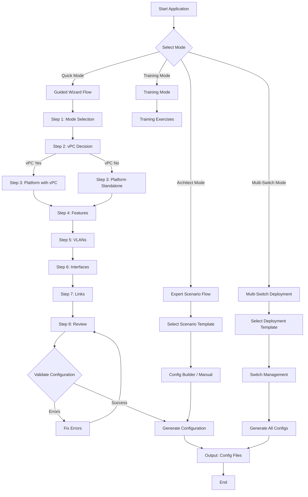

## Detailed Wizard Decision Tree

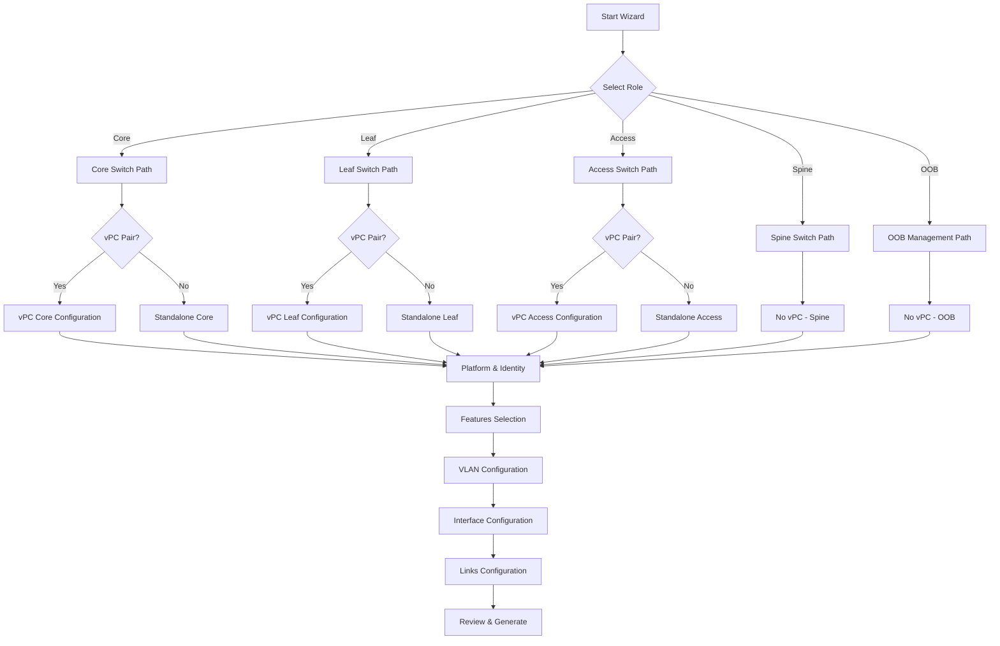

## vPC Configuration Flow

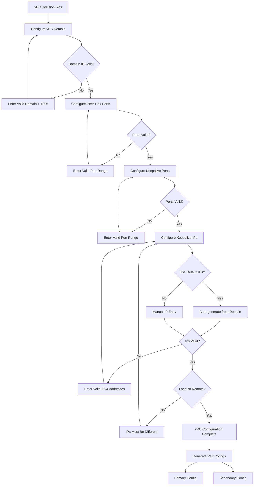

## Multi-Switch Deployment Flow

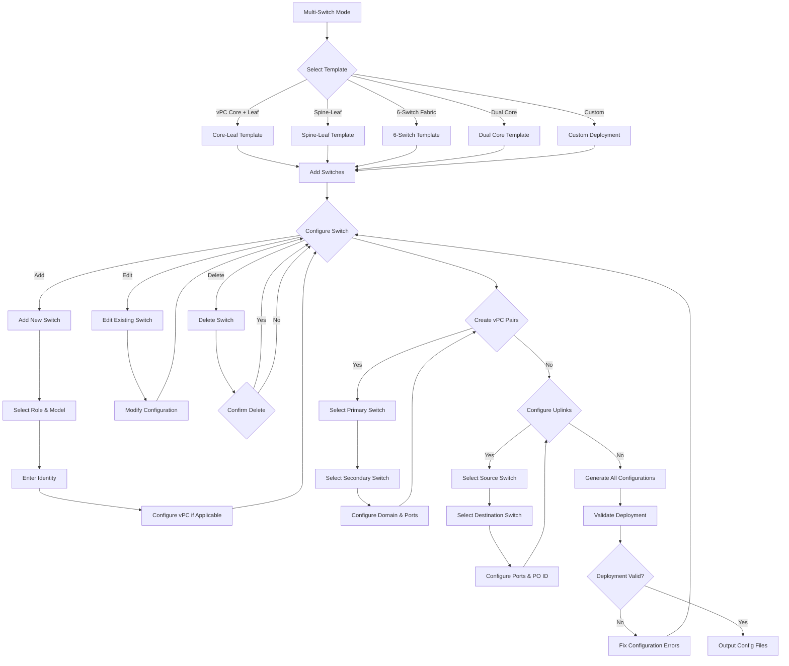

## Configuration Generation Flow

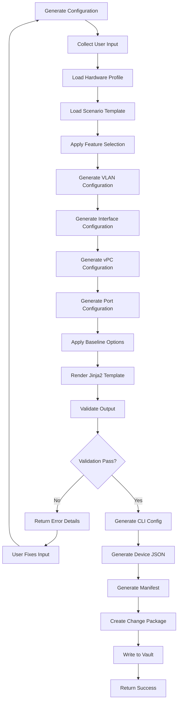

## Error Handling Flow

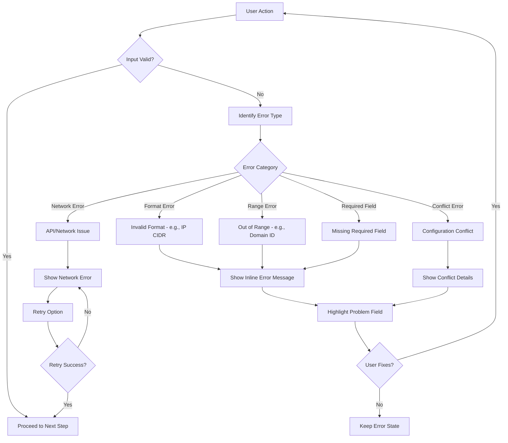

## Feature Selection Flow

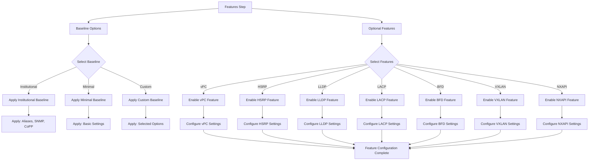

## VLAN Configuration Flow

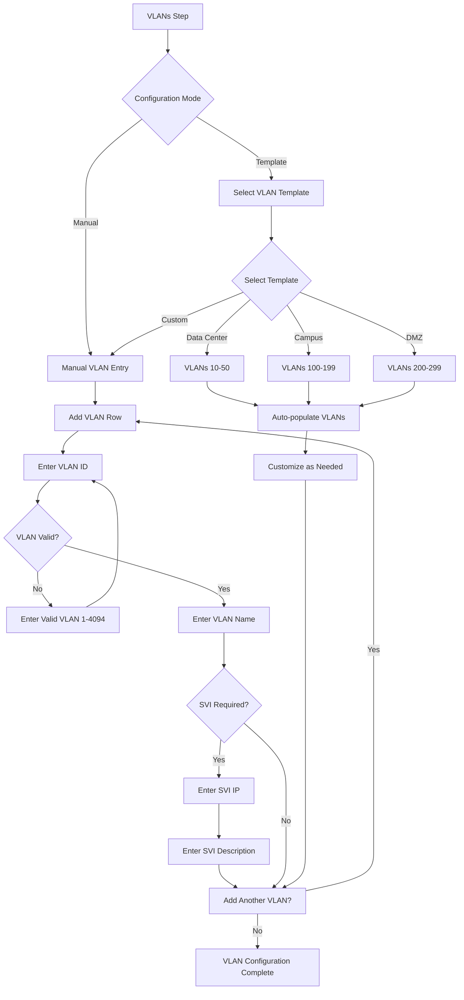

## Interface Configuration Flow

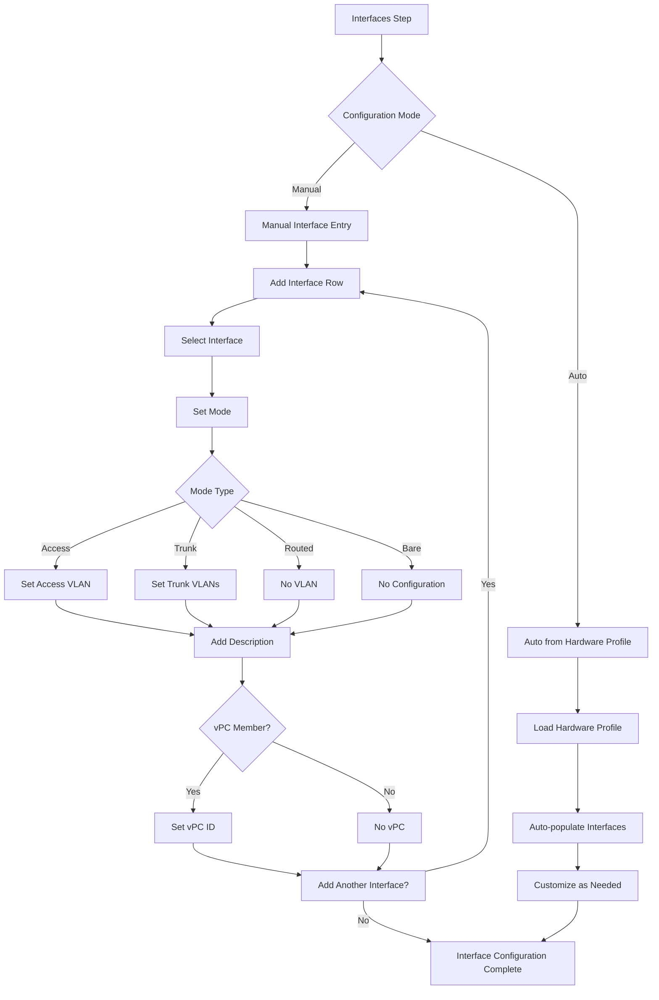

## Links Configuration Flow

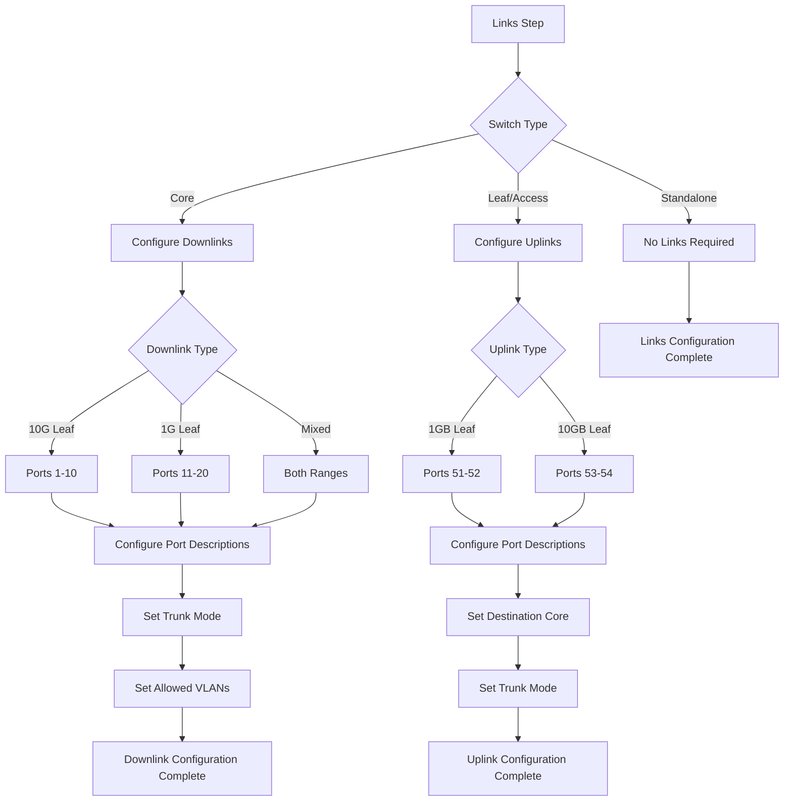

## Review and Generation Flow

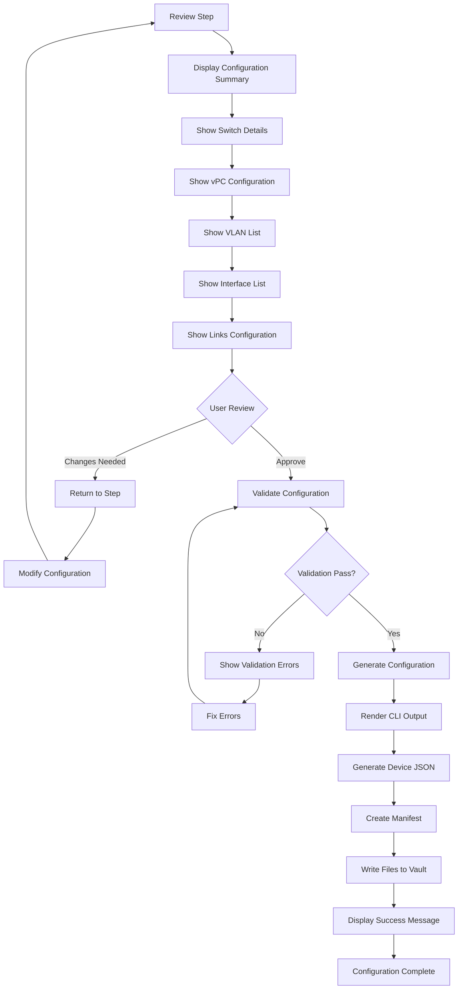

## Progress Tracking Flow

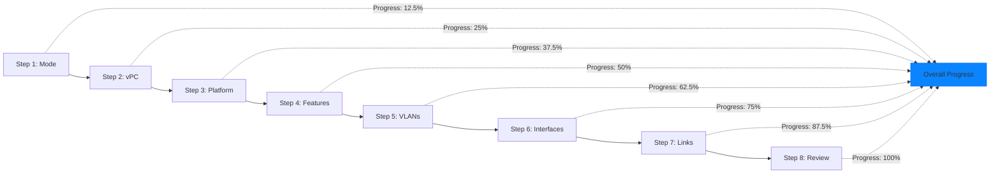

## Decision Points Summary

| Step | Decision | Options | Impact |
|------|----------|---------|--------|
| Mode Selection | Operating Mode | Quick, Architect, Multi-Switch, Training | Determines entire workflow |
| Role Selection | Switch Role | Core, Leaf, Access, Spine, OOB | Sets available features |
| vPC Decision | vPC Enabled | Yes, No | Enables/disables vPC configuration |
| Platform | Hardware Model | 9336C-FX2, 93180YC-EX, 9348GC-FXP | Determines port availability |
| Features | Baseline Options | Institutional, Minimal, Custom | Sets default configuration |
| Features | Optional Features | vPC, HSRP, LLDP, LACP, BFD, VXLAN, NXAPI | Enables specific capabilities |
| VLANs | Configuration Mode | Manual, Template | Speed of configuration |
| Interfaces | Configuration Mode | Manual, Auto | Level of customization |
| Links | Link Type | Uplink, Downlink, None | Network topology |
| Review | Approval | Approve, Modify | Final generation decision |

## Complexity Analysis

### Current Complexity (8 Steps)
- **Decision Points**: 15+
- **Possible Paths**: 50+
- **Average Clicks to Complete**: 40-60
- **Cognitive Load**: High (multiple contexts)

### Proposed Complexity (5 Steps)
- **Decision Points**: 10
- **Possible Paths**: 25
- **Average Clicks to Complete**: 25-35
- **Cognitive Load**: Medium (consolidated contexts)

## Key Improvement Areas

1. **Reduce Decision Fatigue**: Consolidate related decisions
2. **Simplify Navigation**: Fewer steps, clearer progression
3. **Improve Context**: Keep related information together
4. **Enhance Feedback**: Better error messages and validation
5. **Visual Clarity**: Better representation of complex configurations

## Conclusion

This decision flow analysis reveals that while the NX-OS Configurator is comprehensive, the current 8-step wizard creates unnecessary complexity. By consolidating related decisions and improving the visual hierarchy, we can significantly reduce cognitive load while maintaining all functionality. The proposed improvements focus on simplifying the existing user journey without adding new features.
